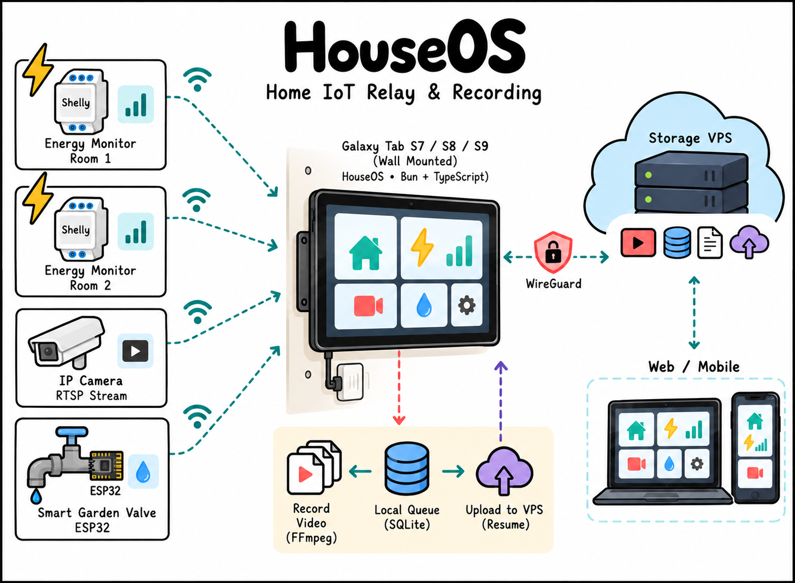

# HouseOS

Your house has an operating system. Cheap. Robust. Lightweight.

Formerly **TWIOT** (Third World Internet of Things).



## Roadmap

- Edge relay: Galaxy Tab S7/S8/S9, Bun + TypeScript (WIP)
- Energy monitor: Shelly meters (WIP)
- Telemetry relay: SQLite queue, upload to VPS (WIP)
- CCTV: RTSP recording with FFmpeg (WIP)
- Smart garden valve: ESP32 (WIP)
- Storage VPS over WireGuard (WIP)
- Web / mobile dashboard (WIP)

## Legacy submodules

The original TWIOT components keep their names and URLs for compatibility.

- [twiot-gateway](https://github.com/vmasdani/twiot-gateway)
- [twiot-smart-garden-valve](https://github.com/vmasdani/twiot-smart-garden-valve)

```
git submodule update --init --recursive
```
